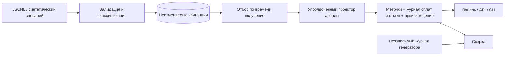

# ProductPulse

**История за цифрами: проверяемая аналитика аренды оборудования.**

Панель показывает не только стоимость бронирований и конверсию, но и то, почему они изменились после поздней доставки. Любую операцию можно раскрыть до цепочки `просмотр → расчёт → бронирование → оплата`, исходного JSON, времени получения и SHA-256.

Проект использует только воспроизводимые синтетические данные. Это индивидуальная лаборатория с явными ограничениями, а не заявление об опыте работы с реальными клиентами.

## Что можно проверить

- Повтор доставки сохраняется, но не удваивает показатель. Конфликт ID попадает в карантин; первая принятая версия остаётся исходной.
- Исторический срез восстанавливает **то, что было известно**, отдельно от периода совершения событий.
- Платёж без предшествующего бронирования сначала исключается, а после запоздавшей доставки цепочки становится действительным.
- Полная отмена уменьшает стоимость в день отмены, в том числе для оплаты из предыдущего периода.
- Воронка соблюдает порядок этапов; когортное удержание различает завершённые, неполные и ещё не наблюдаемые недели.
- Демо сверяет результат проектора с независимым журналом генератора. CSV сохраняет суммы со знаком и происхождение операций.

## Быстрый запуск без сервисов

Требуется Python 3.12. Команды выполняются из корня проекта; виртуальное окружение активируется обычным для вашей системы способом.

```shell
python -m venv .venv
# Windows PowerShell: .venv\Scripts\Activate.ps1
# Linux / macOS: source .venv/bin/activate
python -m pip install -c constraints.txt -e ".[dev]"
productpulse --database sqlite:///demo.db demo
productpulse --database sqlite:///demo.db serve
```

Откройте [локальную панель](http://127.0.0.1:8010/). Демо по умолчанию: `seed=27`, 240 потенциальных пользователей, 8 недель, период `2026-01-05` — `2026-03-02` (правая граница не включается). Контрольные итоги: 301 оплаченная аренда, 38 отмен, **60 272 USD** чистой стоимости бронирований. Генератор и программа сверяют эти значения автоматически; несовпадение даёт ненулевой код завершения.

Для другого сценария используйте **новую базу**: ID детерминированы и не предназначены для смешивания разных seed. Повтор того же демо допустим: добавятся квитанции повторов, показатели останутся прежними.

## PostgreSQL — основной режим

Укажите URL через `PRODUCTPULSE_DATABASE_URL`, например локальную базу с драйвером `postgresql+psycopg`. Настоящие данные подключения не записывайте в репозиторий и командную историю.

```shell
productpulse init
productpulse demo
productpulse serve
```

Либо используйте контейнерный сценарий:

```shell
docker compose up -d db
docker compose run --rm app demo
docker compose up app
```

Compose использует только локальный демонстрационный пароль, публикует панель на `127.0.0.1:8010` и не публикует порт базы. Контейнерный сценарий предоставлен для воспроизведения; результаты локальной проверки и ограничения перечислены в [отчёте проверок](docs/VERIFICATION.md).

## Разобрать позднее событие за три минуты

```shell
productpulse --database sqlite:///late.db ingest examples/late-payment.jsonl --source checkout --received-at 2026-01-06T00:00:00Z
productpulse --database sqlite:///late.db ingest examples/late-predecessors.jsonl --source delayed-sync --received-at 2026-01-08T00:00:00Z
productpulse --database sqlite:///late.db compare --start 2026-01-01 --end 2026-02-01 --before 2026-01-07T00:00:00Z --after 2026-01-09T00:00:00Z
```

Ожидаемое изменение `net_cents`: **+10000**, то есть 100 USD. В раннем срезе оплата известна, но у неё нет цепочки. В позднем срезе добавляются предшественники с более ранним **временем события**. Исходная оплата не переписывается. Пошаговый разбор панели — в [русском руководстве](docs/WALKTHROUGH.md).

## CLI и API

```shell
productpulse report --start 2026-01-05 --end 2026-03-02 --as-of 2026-03-09T00:00:00Z
productpulse report --start 2026-01-05 --end 2026-03-02 --channel organic --category camera
productpulse export --start 2026-01-05 --end 2026-03-02
productpulse ingest events.jsonl --source checkout
productpulse --help
```

Для выбранного файла или URL базы добавляйте `--database` **до** подкоманды. `report` выводит JSON, `export` — CSV в стандартный вывод; перенаправление выполняйте в UTF-8. Без `--received-at` CLI назначает текущее UTC-время. Время получения из внешнего файла не считается доверенным серверным временем.

Локальная [справка API](http://127.0.0.1:8010/docs) работает без CDN; [схема OpenAPI](http://127.0.0.1:8010/openapi.json) доступна отдельно. API содержит только GET: `/api/report`, `/api/compare`, `/api/receipts`, `/api/export`, `/api/health`. Swagger UI и ReDoc отключены для строгой политики ресурсов.

## Архитектура



| Часть | Ответственность |
|---|---|
| `domain.py` | Строгий JSON-контракт, нормализация UTC и содержимого |
| `store.py` | Транзакционная загрузка, блокировка писателя, уникальность, защита от UPDATE/DELETE |
| `analytics.py` | Единственная семантика срезов, цепочек, показателей, удержания и сравнения |
| `simulator.py` | Детерминированные доставки, повторы, конфликты, задержки и независимый денежный журнал |
| `api.py`, `cli.py` | Интерфейсы одной модели, экспорт и предсказуемые ошибки |
| `static/` | Адаптивная русская панель без внешних ресурсов и сборщика |

Подробнее: [контракт](DESIGN.md), [семантика показателей](docs/METRICS.md), [SQL-проверки](sql/audit.sql).

## Проверки

```shell
python -m pytest -q
python -m ruff check src tests
python -m ruff format --check src tests
```

Для PostgreSQL задайте `PRODUCTPULSE_TEST_DATABASE_URL` отдельной тестовой базы. Каждый тест создаёт случайную схему `test_<uuid>` и удаляет только её; `public` не очищается. У тестового пользователя должны быть права создания схем и функций. CI запускает SQLite и PostgreSQL 17, форматирование и сверку CLI. `constraints.txt` фиксирует версии проверенного окружения, не заменяя декларацию зависимостей в `pyproject.toml`.

## Границы применения

Проектор загружает выбранную историю в память и пересчитывает её целиком. Здесь нет потоковой платформы, материализованных витрин, аутентификации или промышленного развёртывания. PostgreSQL-блокировка сериализует загрузчики; это осознанный выбор для детерминированной демонстрации.

Триггеры защищают обычные UPDATE/DELETE, но владелец базы с административными правами может отключить защиту. SHA-256 обнаруживает изменение содержимого при сравнении, но не является цифровой подписью внешнего источника. Срез с задним числом воспроизводим при неизменной истории; импортёр, которому разрешено задавать `received_at`, может дополнить историю задним числом.

Панель видит исходный JSON и не имеет входа по паролю. Используйте только синтетические данные, локальный адрес и отдельную демонстрационную базу. Чистая стоимость бронирований — продуктовый показатель, **не бухгалтерская выручка**.
